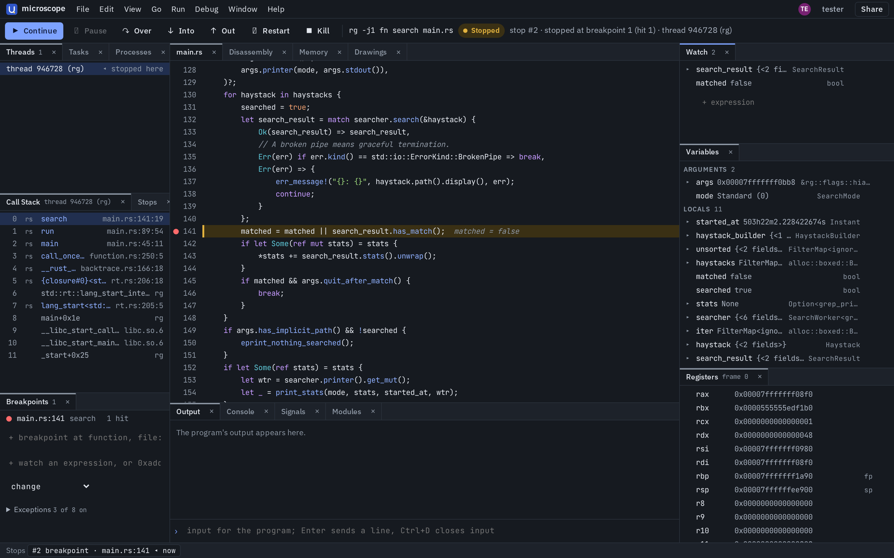
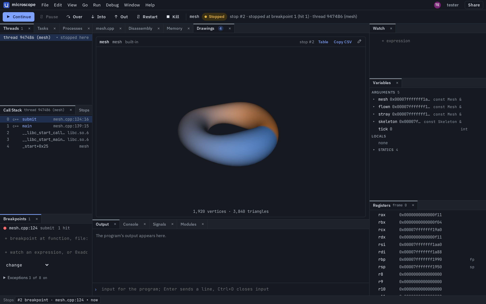
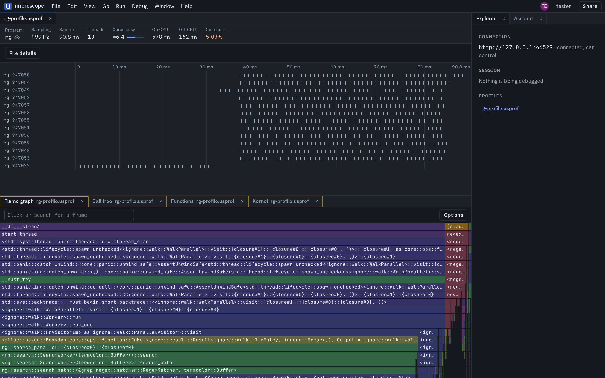
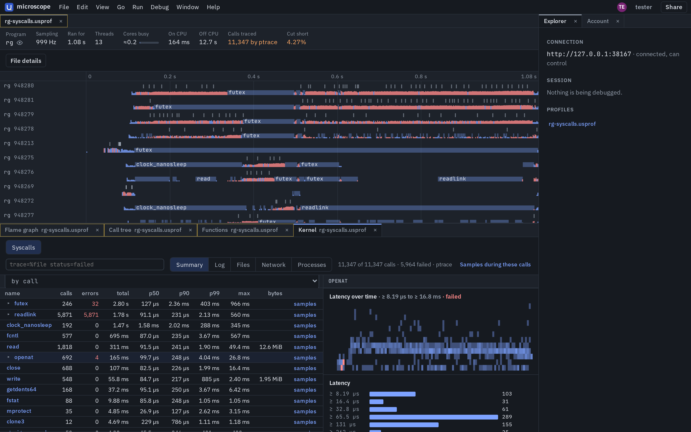

# microscope

Microscope is an all-in-one observability tool for Linux `x86-64`.

It combines interactive debugging, core-dump analysis, sampling profiling, and syscall tracing in a single binary. You can use it from the terminal, a browser UI, or your editor over DAP. More observability techniques are coming soon!

## Goals

- A single tool to handle all your observability needs, from day-to-day metrics/logs/traces/profiles, to advanced performance analysis, to step debugging, and more.
- Safe and suitable for all systems from local dev all the way through to production
- First-class support for a variety of programming languages and runtimes
- O11y is inherently a problem of data visualization, so microscope provides easy-to-use data visualizations for common patterns, and it's easy to write custom visualizers for your own data types.

## Support

- **Platform:** Linux `x86-64`. Kernel 5.15+ with BTF is required for eBPF profiling and non-stopping syscall tracing; `ptrace` is available as an unprivileged fallback on local dev machines only (ptrace is not safe in production).
- **Interfaces:** CLI REPL, embedded web UI (`microscope web`), and Debug Adapter Protocol (`microscope dap`) for VS Code and Neovim.
- **Languages and runtimes:** C, C++, Rust (with Tokio), Go, Zig, Python (CPython), and JavaScript/TypeScript (Node.js/V8), plus DWARF support for Odin, Fortran, D, Nim, and Ada.

## License

Licensed under either [MIT](LICENSE-MIT) or [Apache-2.0](LICENSE-APACHE), at your option.

## Security

Please see [SECURITY.md](SECURITY.md)

## Getting Started

### Build from source

Development uses a pinned Nix shell (`./scripts/dev.sh`) and [`just`](https://github.com/casey/just). For instance:

```sh
./scripts/dev.sh
just web-build
cargo build --release --bin microscope
```

This builds `./target/release/microscope` with the web UI embedded. To build a static `musl` binary instead:

```sh
just web-build
just build-static release
```

### Examples

#### Step debugging (ripgrep)

Build [ripgrep](https://github.com/BurntSushi/ripgrep) in debug mode (`cargo build`), then launch it under microscope:

```sh
microscope ./target/debug/rg -- -j1 "fn search" crates/core/main.rs
```

Set a breakpoint, run to it, inspect values, and step over lines:

```text
(microscope) break main.rs:141
breakpoint 1 set at search at crates/core/main.rs:141
(microscope) run
113:fn search(args: &HiArgs, mode: SearchMode) -> anyhow::Result<bool> {
166:fn search_parallel(args: &HiArgs, mode: SearchMode) -> anyhow::Result<bool> {
stopped at breakpoint 1 (hit 1) in search at crates/core/main.rs:141
    138 |                 continue;
    139 |             }
    140 |         };
●=> 141 |         matched = matched || search_result.has_match();
    142 |         if let Some(ref mut stats) = stats {
    143 |             *stats += search_result.stats().unwrap();
(microscope) print search_result
(SearchResult) search_result = {has_match = true, stats = None}
(microscope) print matched
(bool) matched = false
(microscope) next
stopped after source next in search at crates/core/main.rs:142
    139 |             }
    140 |         };
●   141 |         matched = matched || search_result.has_match();
 => 142 |         if let Some(ref mut stats) = stats {
    143 |             *stats += search_result.stats().unwrap();
    144 |         }
    145 |         if matched && args.quit_after_match() {
(microscope) print matched
(bool) matched = true
(microscope) continue
inferior exited with status 0
```

Step into calls and inspect the call stack:

```text
(microscope) break main.rs:132
breakpoint 1 set at search at crates/core/main.rs:132
(microscope) run
stopped at breakpoint 1 (hit 1) in search at crates/core/main.rs:132
    129 |     )?;
    130 |     for haystack in haystacks {
    131 |         searched = true;
●=> 132 |         let search_result = match searcher.search(&haystack) {
    133 |             Ok(search_result) => search_result,
(microscope) step
stopped after source step in search<grep_cli::wtr::StandardStream> at crates/core/search.rs:249
   246 |         &mut self,
   247 |         haystack: &crate::haystack::Haystack,
   248 |     ) -> io::Result<SearchResult> {
=> 249 |         let bin = if haystack.is_explicit() {
   250 |             self.config.binary_explicit.clone()
(microscope) bt
#0  0x0000555555667f53 in search<…> at crates/core/search.rs:249
#1  0x00005555556ed896 in search at crates/core/main.rs:132
#2  0x00005555556eb97b in run at crates/core/main.rs:89
#3  0x00005555556ebda1 in main at crates/core/main.rs:45
```

Run commands non-interactively with `--batch`:

```sh
microscope --batch -e 'break main.rs:141' -e run -e 'print search_result' -e continue \
    ./target/debug/rg -- -j1 "fn search" crates/core/main.rs
```

Attach to a running process or inspect a core dump:

```sh
microscope -p 1234                 # attach by PID or process name
microscope --core core.1234 ./target/debug/rg
```

#### Browser UI

Open the web workbench on a program:

```sh
microscope web ./target/debug/rg -- -j1 "fn search" crates/core/main.rs
```



Inspect program data with built-in or custom visualizers defined in `.views` files (for example, rendering a C++ `Mesh` from memory):

```sh
microscope web --views tests/fixtures/cpp/mesh/mesh.views build/test-programs/mesh
```



#### Profiling and syscalls

Record a CPU/off-CPU profile and explore the thread lanes and flame graph:

```sh
microscope record -o rg.usprof -- ./target/debug/rg "fn search" crates/
microscope report rg.usprof --tree
microscope web rg.usprof
```



Record syscalls and open the **Kernel** tab to inspect call summaries, timelines, and latency heatmaps:

```sh
microscope record --syscalls calls -o rg-syscalls.usprof -- ./target/debug/rg "fn search" crates/
microscope web rg-syscalls.usprof
```



**Permissions:** Launching programs works unprivileged. Attaching to running processes follows `kernel.yama.ptrace_scope`. eBPF profiling and non-stopping syscall tracing require `CAP_BPF` and `CAP_PERFMON` (or pass `--syscall-engine ptrace` when launching).
